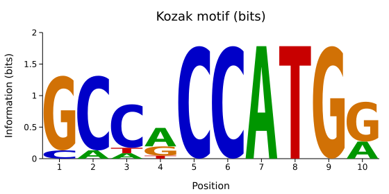
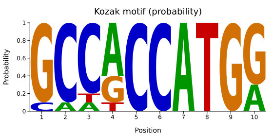
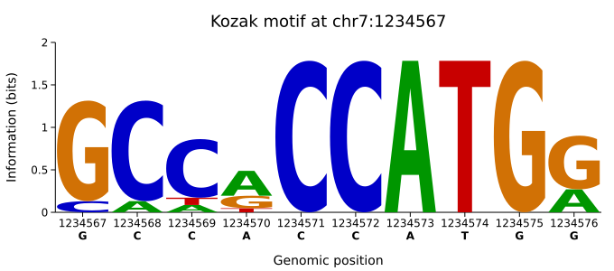
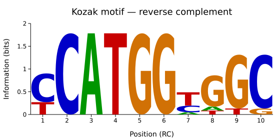
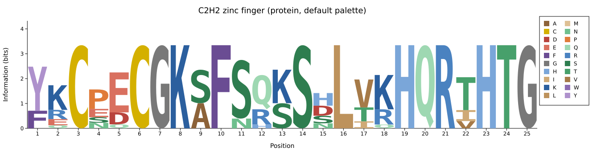
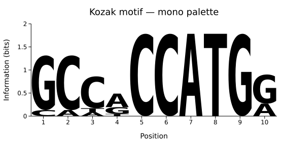

# Sequence Logo

A sequence logo displays a position-weight matrix as a column of stacked
letters — one column per position, letter height proportional to the letter's
contribution at that position. Bits (Schneider / Stephens information
content), raw probability, and count-frequency are all supported. Letters
are drawn as filled vector glyph outlines lifted from a bundled bold
typeface, so a stretched glyph stays crisp at any output resolution.

Letters are stretched to fill their column (less a 3% inset), which is the
classic WebLogo look but flattens any glyph whose outline is a bare
rectangle — a plain sans capital `I` becomes an anonymous block. The
bundled face (DejaVu Sans Mono Bold) gives `I` serifs, so it survives the
stretch.

**Import path:** `kuva::plot::logo::SequenceLogo`
**Feature gate:** `logo` (adds `ttf-parser` + the bundled bold-font asset).

---

## From aligned FASTA

`SequenceLogo::from_sequences` counts non-gap letters per position, applies
Schneider's small-sample correction in bits mode, and returns a ready
logo. Ambiguity codes (`N`, `R`, `Y`, …) are dropped with a one-time
warning; gap characters are excluded from the alphabet by default.

```rust,no_run
use kuva::backend::svg::SvgBackend;
use kuva::plot::logo::{Alphabet, SequenceLogo};
use kuva::render::layout::Layout;
use kuva::render::plots::Plot;
use kuva::render::render::render_multiple;

let logo = SequenceLogo::from_sequences(
    vec![
        "GCCACCATGG",
        "CCCACCATGG",
        "GCCGCCATGG",
        "GCCACCATGA",
    ],
    Alphabet::Dna,
).unwrap();

let plots: Vec<Plot> = vec![logo.into()];
let layout = Layout::auto_from_plots(&plots)
    .with_title("Kozak motif (bits)")
    .with_x_label("Position")
    .with_y_label("Information (bits)");

let svg = SvgBackend.render_scene(&render_multiple(plots, layout));
std::fs::write("kozak.svg", svg).unwrap();
```



The x-axis is automatically pinned to integer positions and the background
grid is suppressed — logos read as stacks, not as points on a grid.

---

## Probability mode

`with_units(LogoUnits::Probability)` switches the y-axis to raw
probabilities in `[0, 1]`. Small-sample correction is not applied in
probability mode.

```rust,no_run
# use kuva::plot::logo::{Alphabet, LogoUnits, SequenceLogo};
let logo = SequenceLogo::from_sequences(sequences, Alphabet::Dna)
    .unwrap()
    .with_units(LogoUnits::Probability);
```



---

## Genomic coordinates and consensus row

`with_start(n)` shifts the displayed axis labels so position 1 in the input
appears as *n* on the axis — handy when the motif sits at a specific
genomic coordinate. `with_consensus()` adds a per-position consensus letter
below the plot; letters below `consensus_threshold` (default 0.5) render
lowercase.

```rust,no_run
# use kuva::plot::logo::{Alphabet, SequenceLogo};
let logo = SequenceLogo::from_sequences(sequences, Alphabet::Dna)
    .unwrap()
    .with_start(1_234_567)
    .with_consensus()
    .with_consensus_threshold(0.6);
```



---

## Reverse complement

Nucleic-only. `with_reverse_complement()` returns `Err` on protein alphabets.

```rust,no_run
# use kuva::plot::logo::{Alphabet, SequenceLogo};
let logo = SequenceLogo::from_sequences(sequences, Alphabet::Dna)
    .unwrap()
    .with_reverse_complement()
    .unwrap();
```



---

## Palette presets and per-letter overrides

Seven presets ship out of the box, in two families.

*Chemistry-group* palettes — `Classic`, `WebLogo`, `Clustal` — deliberately
share one color across a whole group, so you read chemistry at a glance but
cannot tell two hydrophobic residues apart.

*Per-residue* palettes give every letter its own color. `Muted` is the
protein default: one hue family per chemistry group — browns for the
aliphatic residues, purples for aromatics, blues for basic, reds for acidic,
greens for polar, and G / P / C each their own (grey, orange, sulfur yellow)
— stepped in lightness inside each group, so chemistry stays legible **and**
residues stay distinct, at a mid saturation that is comfortable when a glyph
fills half the plot. `Shapely`
(RasMol) and `Taylor` are also per-residue but fully saturated — they were
designed for small letters in an alignment viewer and glare at logo scale.



The protein legend lists every residue that appears; the canvas widened
itself to keep ~48 px per position (set `with_width` / `--width` to override).

Nucleotides default to `Classic` (the familiar green/blue/amber/red ACGT).
`Mono` renders everything black. Add per-letter overrides on top with
`with_colors`.

The legend follows suit: it draws one row per *distinct color*, labelled
with the letters sharing it, so a chemistry palette yields five rows
(`AFILMPVW`, `CGSTY`, `DE`, `HKR`, `NQ`) and Taylor yields twenty.

```rust,no_run
# use kuva::plot::logo::{Alphabet, PalettePreset, SequenceLogo};
let logo = SequenceLogo::from_sequences(sequences, Alphabet::Dna)
    .unwrap()
    .with_preset(PalettePreset::Mono);
```



---

## From a pre-computed matrix

Rows are positions, columns follow `alphabet.letters()`. Row values may be
raw counts or already-normalised probabilities — the renderer normalises
each row independently.

```rust,no_run
# use kuva::plot::logo::{Alphabet, SequenceLogo};
let matrix = vec![
    vec![0.1, 0.1, 0.7, 0.1],
    vec![0.0, 0.7, 0.2, 0.1],
    // …
];
let logo = SequenceLogo::from_matrix(matrix, Alphabet::Dna);
```

---

## Notes on the math

- **Shannon information content** at a position is `log₂(N) − H(p)` where
  `H(p) = −Σ pₖ log₂ pₖ`, `N` is the alphabet size (4 for DNA, 20 for
  protein).
- **Schneider small-sample correction** subtracts `e_n = (s − 1) /
  (2 ln 2 · n)` from the raw IC, where `s` is the alphabet size and `n` is
  the number of sequences. Applied by default when the logo was built from
  `from_sequences`; disable with `with_no_correction()`.
- **Negative corrected IC** is clipped at 0 (matches WebLogo).
- **Ambiguity codes** (`N`, `R`, `Y`, `X`, …) are excluded from counts
  with a one-time stderr warning; they never contribute fractional
  probability to canonical letters.

---

## CLI

**Requires the `logo` feature** (included in `--features full`).

**Input:** either an aligned FASTA file (`.fa`, `.fasta`, `.fna`, `.faa`,
`.aln`, `.afa`) or a matrix file (`.csv`, `.tsv`, `.txt`, `.pwm`, `.ppm`).
The mode is autodetected from the extension, then from the first non-empty
line if the extension is ambiguous; `--from {fasta,matrix}` forces one.
Omit the input or pass `-` to read stdin.

| Flag | Default | Description |
|---|---|---|
| `--from <MODE>` | *autodetect* | Force input interpretation: `fasta` or `matrix` |
| `--alphabet <NAME\|LETTERS>` | `dna` | `dna`, `rna`, `protein`, or a raw letter string for a custom alphabet (e.g. `--alphabet MHUL`) |
| `--units <UNITS>` | `bits` | Y-axis units: `bits`, `probability`, or `frequency` |
| `--palette <PRESET>` | `classic` (DNA/RNA), `muted` (protein/custom) | Letter color preset: `muted`, `classic`, `weblogo`, `shapely`, `clustal`, `taylor`, `mono`. Chemistry-group presets (`classic`, `weblogo`, `clustal`) share one color across a group; per-residue presets (`muted`, `shapely`, `taylor`) give every letter its own. For this subcommand `--palette` selects the letter preset, not a chrome palette |
| `--colors <SPEC>` | — | Per-letter overrides layered on top of the preset, e.g. `"A=#00CC00,C=#0000CC"` |
| `--start <INT>` | `1` | Display position 1 as `<INT>` (genomic coordinates) |
| `--reverse-complement` | off | Reverse-complement the motif (nucleic alphabets only; RNA displays U) |
| `--consensus` | off | Draw a consensus-letter row below the plot |
| `--consensus-threshold <F>` | `0.5` | Fraction above which consensus letters render uppercase |
| `--respect-case` | off | Treat lowercase input as soft-masked (counted as gaps). FASTA input only |
| `--include-gaps` | off | Count gap characters (`-`, `.`) as their own stack column. FASTA input only |
| `--no-correction` | off | Skip Schneider's small-sample correction (bits mode, FASTA input only) |
| `--orientation <MODE>` | *autodetect* | Force matrix orientation: `rows` = positions × letters (WebLogo/MEME/HOMER), `cols` = letters × positions (JASPAR) |

Standard `--output`, `--title`, `--x-label`, `--y-label`, `--width`,
`--height`, `--theme`, and `--terminal` flags apply.

```bash
# FASTA in, SVG out
kuva logo motif.fasta -o motif.svg

# PWM in, probability mode
kuva logo pwm.tsv --units probability -o pwm.svg

# Genomic coordinates with a consensus row
kuva logo motif.fasta --start 1234567 --consensus -o motif.svg

# Reverse-complement view (DNA/RNA only)
kuva logo motif.fasta --reverse-complement -o motif_rc.svg

# Protein motif with per-residue colors and the automatic letter legend
kuva logo domain.faa --alphabet protein --palette taylor -o domain.svg

# Custom colors
kuva logo motif.fasta \
    --colors "A=#00CC00,C=#0000CC,G=#FFB300,T=#CC0000" \
    -o motif.svg
```

Automatic behaviors: grid lines are suppressed (logos read as stacks, not
points on a grid); the x-axis is pinned to integer positions; protein and
custom alphabets draw a letter legend while DNA/RNA hide it (the library's
`with_legend()` / `with_no_legend()` override this); a logo's `with_title`
flows into `Layout::auto_from_plots` when the layout has no title of its
own; long motifs widen the canvas automatically (about 48 px per position)
unless `--width` is given.
With `--terminal`, letters stack cell-by-cell per position, cell count
proportional to information content.
