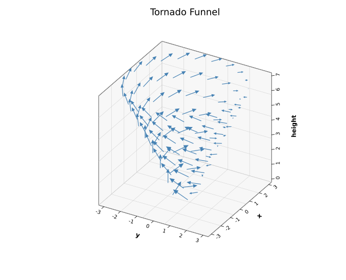
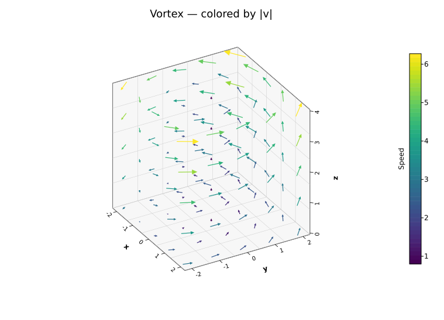
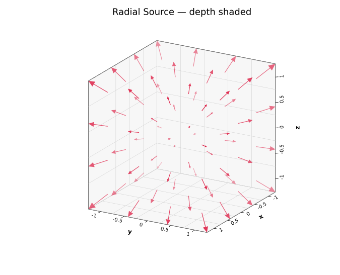

# 3D Quiver Plot

A 3D quiver plot visualises a vector field in three dimensions. Each arrow is anchored at data coordinates `(x, y, z)` and points along a vector `(u, v, w)`. Arrows are projected with the same orthographic camera as the [3D Scatter Plot](./scatter3d.md), drawn inside the same open-box wireframe, and painted back to front so nearer arrows cover farther ones. Use it for flow fields, force fields, gradients of a 3D scalar, magnetic or wind vectors — any data where every point in space has a direction and a magnitude.

**Import path:** `kuva::plot::quiver3d::Quiver3DPlot`

---

## Basic usage

The most common case is sampling a vector-field closure `f: (x, y, z) → (u, v, w)` on a regular grid with `Quiver3DPlot::from_function`:

```rust,no_run
use kuva::plot::Quiver3DPlot;
use kuva::backend::svg::SvgBackend;
use kuva::render::render::render_multiple;
use kuva::render::layout::Layout;
use kuva::render::plots::Plot;

// Vortex around the z axis with a gentle updraft, on a 5×5×5 grid.
let plot = Quiver3DPlot::from_function(
    (-2.0, 2.0, 5),
    (-2.0, 2.0, 5),
    (0.0, 4.0, 5),
    |x, y, _z| (-y, x, 0.8),
)
    .with_color("steelblue")
    .with_x_label("x")
    .with_y_label("y")
    .with_z_label("z");

let plots = vec![Plot::Quiver3D(plot)];
let layout = Layout::auto_from_plots(&plots).with_title("3D Vector Field");

let svg = SvgBackend.render_scene(&render_multiple(plots, layout));
std::fs::write("quiver3d.svg", svg).unwrap();
```

For irregular data, add arrows one at a time with `.with_arrow(x, y, z, u, v, w)` or pass an iterator of `(x, y, z, u, v, w)` tuples to `.with_arrows()`:



---

## Coloring by magnitude

Passing a `ColorMap` colors each arrow by its magnitude `sqrt(u² + v² + w²)` and renders a colorbar automatically. `with_magnitude_colormap(cmap, label)` sets the colormap and the colorbar label in one call:

```rust,no_run
use kuva::plot::{ColorMap, Quiver3DPlot, QuiverPivot};

let plot = Quiver3DPlot::from_function(
    (-2.0, 2.0, 5),
    (-2.0, 2.0, 5),
    (0.0, 4.0, 5),
    |x, y, z| {
        let swirl = 1.0 + 0.3 * z;
        (-y * swirl, x * swirl, 0.8)
    },
)
    .with_pivot(QuiverPivot::Middle)
    .with_magnitude_colormap(ColorMap::Viridis, "Speed");
```

Priority: per-arrow color (via `.with_colored_arrow()`) > colormap > single color.



---

## View angles and depth shading

Adjust the camera with `with_azimuth` / `with_elevation` (or `with_view(View3D { .. })`), exactly as for the 3D scatter plot. `with_depth_shade()` fades arrows that are farther from the viewer, which helps dense fields read as three-dimensional:

```rust,no_run
use kuva::plot::Quiver3DPlot;

let plot = Quiver3DPlot::from_function(
    (-1.0, 1.0, 4),
    (-1.0, 1.0, 4),
    (-1.0, 1.0, 4),
    |x, y, z| (x, y, z),   // radial source
)
    .with_depth_shade()
    .with_color("crimson")
    .with_azimuth(-120.0)
    .with_elevation(20.0);
```



---

## Scaling

By default the scale multiplier is **auto-computed** so the longest arrow is roughly one grid cell long. The cell is measured in the box's own normalised coordinates, where every axis spans one unit whatever its data range, so a field sampled on `x, y ∈ [0, 100]` and `z ∈ [0, 1]` still gets legible arrows along all three axes. For `n` arrows spread over `k` non-degenerate anchor axes the cell is `n^(-1/k)` box units: `√n` for a planar field, `∛n` for a volume. This keeps dense fields from overlapping no matter what units `(u, v, w)` are in.

- `.with_scale(s)` — pin the multiplier. Arrow length in data coords is `(u, v, w) * s`.
- `.with_auto_scale(fraction)` — keep auto-scaling on, but change the target fraction of a cell (default `0.9`). Values above `1.0` let neighbouring arrows overlap.

When every anchor coincides (a single arrow, or several vectors drawn from one origin) there is no spacing to measure, so the longest arrow is scaled to `fraction` of the padded unit box instead of being drawn at its raw length.

---

## Pivot

By default `(x, y, z)` is the arrow's **tail**. `QuiverPivot::Middle` centres each arrow on its anchor, which reads as "what the field is doing *at* this point", and `QuiverPivot::Tip` makes the anchor the arrow's tip. The pivot type is shared with the 2-D [Quiver Plot](./quiver.md):

```rust,no_run
use kuva::plot::{Quiver3DPlot, QuiverPivot};

let plot = Quiver3DPlot::new()
    .with_arrow(0.0, 0.0, 0.0, 1.0, 0.0, 0.0)
    .with_pivot(QuiverPivot::Middle);
```

---

## Bounds and overlap

By default the coordinate box encloses every arrow, tail to tip, so nothing is drawn outside it — the same default as the 2-D quiver. `.with_tight_bounds()` sizes the box from the **anchors only** instead: the sampled region then fills the box and the outer layer of arrows extends past its faces, which reads naturally for dense fields but can run into the axis tick labels on coarse ones. Arrows are never clipped in either mode; choose `QuiverPivot::Middle` to split any overhang evenly across opposite faces.

Arrows are ordered by the depth of their projected midpoint and drawn back to front (the painter's algorithm, as for the 3D scatter plot). Two arrows that genuinely cross each other in 3D may therefore overlap in the wrong order — a vector backend has no per-pixel depth test.

---

## Arrow styling

Arrow heads are flat triangles built in screen space along the projected shaft, so every arrow looks like an arrow from any view angle, and a head is never longer than the shaft it sits on.

- `.with_shaft_width(px)` — shaft width (default `1.2`).
- `.with_head_ratio(r)` — head length as a fraction of the projected shaft (default `0.28`), clamped to `[4, 14]` pixels.
- `.with_head(length_px, half_width_px)` — pin the head to fixed pixel dimensions; `with_head_length` and `with_head_width` pin one dimension each.

---

## Builder reference

| Method | Default | Description |
|---|---|---|
| `Quiver3DPlot::from_function(xr, yr, zr, f)` | — | Sample `f(x, y, z) → (u, v, w)` on a regular grid; each range is `(min, max, n)` |
| `.with_arrow(x, y, z, u, v, w)` | — | Add one arrow (non-finite values are dropped) |
| `.with_arrows(iter)` | — | Add `(x, y, z, u, v, w)` tuples |
| `.with_colored_arrow(x, y, z, u, v, w, css)` | — | Add one arrow with its own color |
| `.with_color(css)` | `"steelblue"` | Uniform arrow color |
| `.with_scale(s)` | auto | Pin the `(u, v, w)` multiplier |
| `.with_auto_scale(fraction)` | `0.9` | Fraction of a grid cell for the longest arrow |
| `.with_shaft_width(px)` | `1.2` | Shaft width |
| `.with_head(len, half_w)` | proportional | Fixed head size in pixels |
| `.with_head_length(px)` / `.with_head_width(px)` | proportional | Pin one head dimension |
| `.with_head_ratio(r)` | `0.28` | Head length as a fraction of the shaft |
| `.with_head_aspect(a)` | `0.45` | Head half-width as a fraction of head length |
| `.with_head_min_px(px)` / `.with_head_max_px(px)` | `4` / `14` | Clamp for proportional head length |
| `.with_color_map(map)` | — | Color by magnitude; renders a colorbar automatically |
| `.with_color_range(lo, hi)` | data | Magnitude range for colormap normalisation |
| `.with_color_legend_label(s)` | — | Colorbar label |
| `.with_magnitude_colormap(map, label)` | — | Colormap + colorbar label in one call |
| `.with_legend(s)` | — | Legend entry label |
| `.with_pivot(QuiverPivot)` | `Tail` | Where the anchor sits on the arrow |
| `.with_depth_shade()` | off | Fade distant arrows |
| `.with_tight_bounds()` | off | Size the box from anchors only; outer arrows extend past the faces |
| `.with_azimuth(deg)` | `-60.0` | Horizontal viewing angle |
| `.with_elevation(deg)` | `30.0` | Vertical viewing angle |
| `.with_view(View3D)` | — | Set both angles together |
| `.with_x_label(s)` / `.with_y_label(s)` / `.with_z_label(s)` | — | Axis labels |
| `.with_no_grid()` | grid on | Hide grid lines on back walls |
| `.with_no_box()` | box on | Hide the wireframe bounding box |
| `.with_grid_lines(n)` | `5` | Grid/tick divisions per axis |
| `.with_z_axis_right(bool)` | auto | Force Z axis to right (`true`) or left (`false`) |
| `.with_z_axis_auto()` | — | Restore automatic Z-axis placement |

A `Quiver3DPlot` can share a figure with `Scatter3DPlot` and `Surface3DPlot`: all 3D plots in one `render_multiple` call are normalised to one coordinate box, drawn once. Depth ordering is resolved within each plot, not across plots — later plots in the list paint over earlier ones — so an arrow can cover a nearer point from another series.

---

## CLI

**Input:** one row per arrow with six numeric columns: anchor x, y, z and vector u, v, w.

```bash
# Zero config — columns 0..5, auto-scaled arrows.
kuva quiver3d field.tsv \
    --title "3D Vector Field" --x-label "x" --y-label "y" --z-label "z"

# Color by magnitude with a viridis colorbar, arrows centred on their anchors
kuva quiver3d field.tsv --colormap viridis --colorbar-label "Speed" --pivot middle

# Depth shading from another viewpoint
kuva quiver3d field.tsv --depth-shade --azimuth -120 --elevation 20

# Pick columns by name
kuva quiver3d field.tsv \
    --x-col lon --y-col lat --z-col alt --u-col wind_u --v-col wind_v --w-col wind_w
```

### CLI flags

| Flag | Default | Description |
|---|---|---|
| `--x-col <COL>` | `0` | Anchor X column |
| `--y-col <COL>` | `1` | Anchor Y column |
| `--z-col <COL>` | `2` | Anchor Z column |
| `--u-col <COL>` | `3` | Vector x-component column |
| `--v-col <COL>` | `4` | Vector y-component column |
| `--w-col <COL>` | `5` | Vector z-component column |
| `--color <CSS>` | `steelblue` | Arrow color (overridden by `--colormap`) |
| `--arrow-scale <F>` | auto | Pin the `(u, v, w)` multiplier (disables auto-scaling) |
| `--auto-scale <F>` | `0.9` | Fraction of a grid cell for the longest arrow |
| `--shaft-width <PX>` | `1.2` | Shaft width |
| `--head-length <PX>` | proportional | Pin head length (default is 28% of the shaft, clamped to 4–14 px) |
| `--head-width <PX>` | proportional | Pin head half-width |
| `--colormap <NAME>` | — | Color arrows by magnitude: `viridis`, `inferno`, `grayscale` |
| `--colorbar-label <TXT>` | — | Colorbar title (with `--colormap`) |
| `--legend <TXT>` | — | Legend entry label |
| `--pivot <MODE>` | `tail` | Where the anchor sits: `tail`, `middle`, or `tip` |
| `--depth-shade` | off | Fade distant arrows |
| `--tight-bounds` | off | Size the box from anchors only (outer arrows extend past the faces) |
| `--azimuth <DEG>` | `-60` | Horizontal viewing angle |
| `--elevation <DEG>` | `30` | Vertical viewing angle |
| `--x-label <S>` / `--y-label <S>` / `--z-label <S>` | — | Axis labels |
| `--no-grid` | grid on | Hide back-wall grid lines |
| `--no-box` | box on | Hide wireframe bounding box |
| `--grid-lines <N>` | `5` | Grid/tick divisions per axis |
| `--z-axis-left` | auto | Force Z axis to the left side |

**See also:** [Quiver Plot](./quiver.md) for the 2-D equivalent, [3D Scatter Plot](./scatter3d.md) and [3D Surface Plot](./surface3d.md) for the shared 3D box, view angles, and depth shading.

---

*See also: [Shared flags](../cli/index.md#shared-flags) — output, appearance.*
