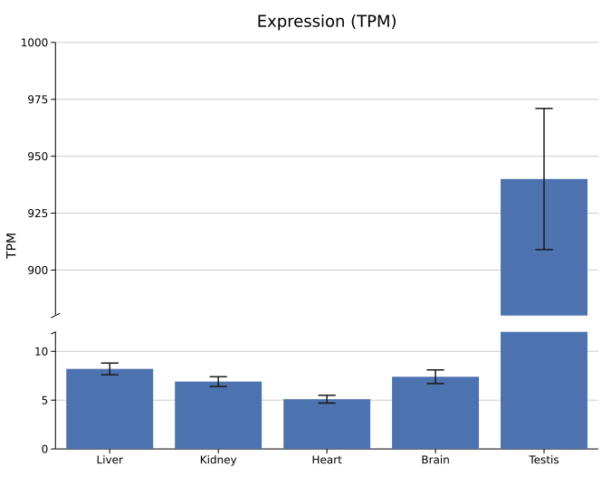
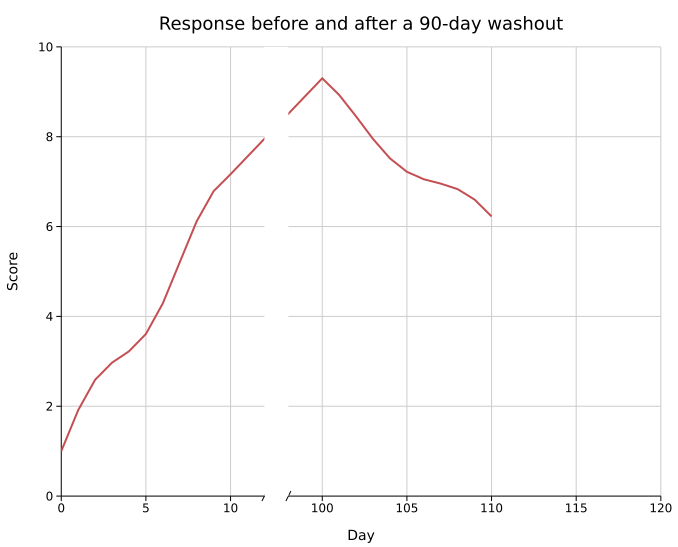
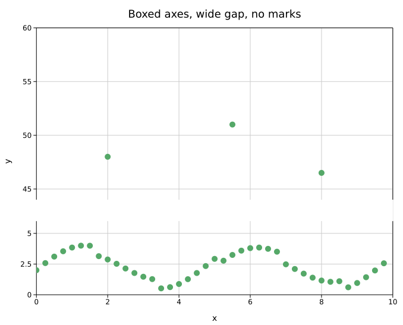
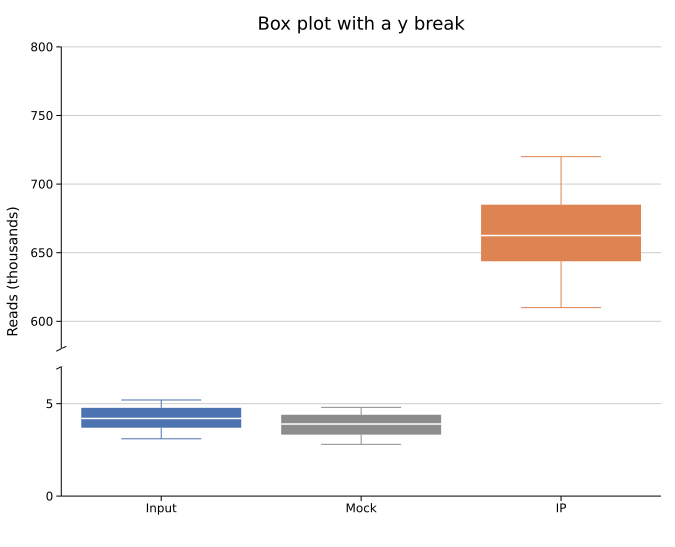

# Axis Breaks

An axis break skips a stretch of a numeric axis so a few far-off values — one dominant tissue, a late time window, a handful of outliers — no longer squash everything else into a sliver. Values up to `lo` and from `hi` on are drawn to scale on either side of a short gap; the stretch between them is simply not shown.

Breaks are a `Layout` feature. Every plot type maps its data through the same axis transform, so bars, boxes, violins, lines, points and error bars all break the same way.

**Import path:** `kuva::plot::AxisBreak` (also in the prelude). The simple form needs no import at all.

---

## Basic usage

```rust,no_run
use kuva::plot::BarPlot;
use kuva::backend::svg::SvgBackend;
use kuva::render::render::render_multiple;
use kuva::render::layout::Layout;
use kuva::render::plots::Plot;

let bar = BarPlot::new()
    .with_bar("Liver", 8.2)
    .with_bar("Kidney", 6.9)
    .with_bar("Heart", 5.1)
    .with_bar("Brain", 7.4)
    .with_bar("Testis", 940.0)
    .with_error(vec![0.6, 0.5, 0.4, 0.7, 31.0]);

let plots = vec![Plot::Bar(bar)];
let layout = Layout::auto_from_plots(&plots)
    .with_y_label("TPM")
    .with_y_break(12.0, 880.0);

let svg = SvgBackend.render_scene(&render_multiple(plots, layout));
```



What you get:

- **Two segments, each to its own scale.** The segment below the break gets a share of the axis that follows the data spans, clamped to 30–70%, so a 12-unit segment next to a 120-unit one is still readable.
- **A gap with break marks.** The axis line stops at `lo`, resumes at `hi`, and carries a slanted mark at each edge. With `AxisLine::Box` the opposite side is split too.
- **Ticks per segment.** Each side gets its own clean tick step, sized by its share of the axis; nothing is labelled inside the gap.
- **A clean gap.** A background-coloured band hides whatever crosses it — a tall bar, a line, a reference line — so the break reads as a break.

---

## X-axis breaks

`with_x_break(lo, hi)` does the same along x. Lines are drawn straight through the gap and clipped by the band.

```rust,no_run
# use kuva::render::layout::Layout;
# let plots = vec![];
let layout = Layout::auto_from_plots(&plots)
    .with_x_label("Day")
    .with_x_break(12.0, 98.0);
```



---

## Configuring the break

`AxisBreak` carries the gap width, the marks and the segment share. Pass it with `with_y_break_config` / `with_x_break_config`.

```rust,no_run
use kuva::plot::AxisBreak;
use kuva::render::layout::{AxisLine, Layout};
# let plots = vec![];
let layout = Layout::auto_from_plots(&plots)
    .with_axis_line(AxisLine::Box)
    .with_y_break_config(
        AxisBreak::new(6.0, 44.0)
            .with_gap(0.08)   // 8% of the plot height (default 4%)
            .with_share(0.4)  // 40% of the axis for the segment below the break
            .with_no_marks(), // plain gap, no slashes
    );
```



| Method | Default | Description |
|--------|---------|-------------|
| `AxisBreak::new(lo, hi)` | — | Skip the values strictly between `lo` and `hi` |
| `.with_gap(frac)` | `0.04` | Gap width as a fraction of the axis length (`0..0.5`) |
| `.with_share(frac)` | data-driven, clamped `0.3..=0.7` | Fraction of the axis (gap excluded) for the segment before the break (`0.05..=0.95`) |
| `.with_no_marks()` | marks on | Omit the slanted break marks |



---

## When a break is ignored

A break that cannot apply is dropped silently rather than producing a broken figure. That happens when:

- `lo >= hi`, or the gap or share is out of range;
- the axis is logarithmic, categorical (the group axis of bar, box, violin, strip, raincloud), or the layout uses `equal_aspect`;
- the break is not strictly inside the resolved axis range, including when `with_y_axis_min` / `with_y_axis_max` pin the range so the break falls outside it.

A y break is also ignored on twin-y plots (the secondary axis shares the plot height on a plain scale, so a primary gap would slice its series) and on candlestick plots (prices are mapped onto their own price/volume panel). The CLI prints a warning whenever a requested break is ignored. Hover read-outs in interactive SVG are disabled on a broken axis, since they assume a linear range.

Two more things to know:

- **Data inside the gap is hidden.** A value between `lo` and `hi` is drawn compressed into the gap and covered by the band, so it looks like a bar sliced at the edge or a missing point. Choose `lo` and `hi` so that no data falls between them.
- **The cover uses the canvas background.** Set the background on the layout (`with_background`, or `--background` on the CLI) rather than on the finished scene so the band matches; with `with_background("none")` (a transparent canvas) the gap is left unmasked.

---

## CLI

Every subcommand with axis flags accepts both:

| Flag | Default | Description |
|------|---------|-------------|
| `--y-break <LO,HI[,SHARE]>` | — | Break the Y axis between LO and HI; optional SHARE for the segment below |
| `--x-break <LO,HI[,SHARE]>` | — | Same for the X axis |

```bash
kuva bar tpm.tsv --label-col tissue --value-col tpm --y-break 12,880
kuva bar tpm.tsv --label-col tissue --value-col tpm --y-break 12,880,0.5 --axis-line box
kuva line response.tsv --x day --y score --x-break 12,98
```

Malformed values (`--y-break 12`, `--y-break 880,12`, a SHARE outside `0.05..0.95`) are rejected with a message. `--emit-code` emits the matching `with_y_break(...)` / `with_y_break_config(...)` call.

---

## API reference

### `Layout`

| Method | Description |
|--------|-------------|
| `with_y_break(lo, hi)` / `with_x_break(lo, hi)` | Break the axis with default gap, marks and share |
| `with_y_break_config(AxisBreak)` / `with_x_break_config(AxisBreak)` | Break the axis with full configuration |

### `ComputedLayout`

| Field | Description |
|-------|-------------|
| `y_break` / `x_break` | The validated break, or `None` when it did not apply |
| `y_break_px` / `x_break_px` | Pixel geometry: the gap edges in data and canvas units, and the scale after the break |
