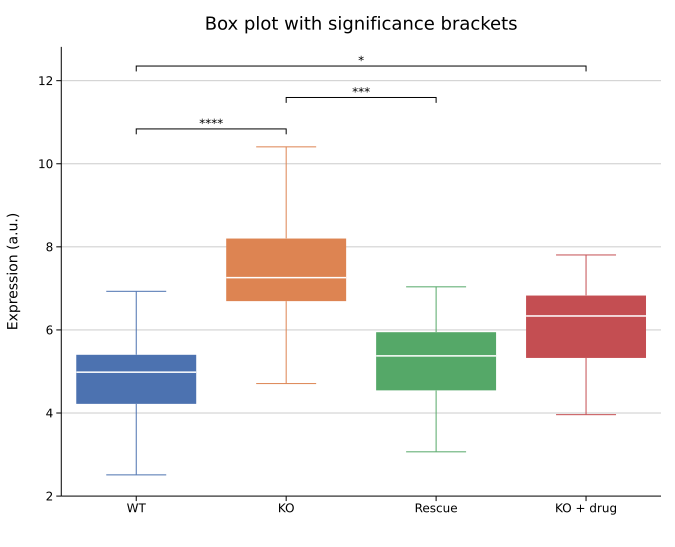
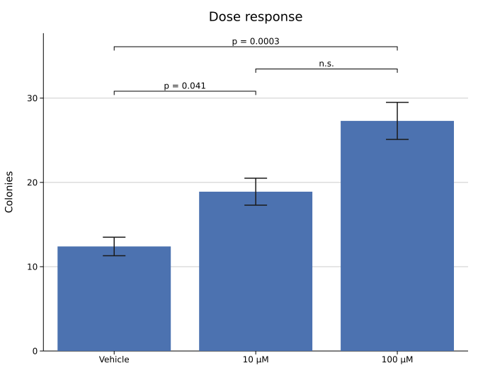
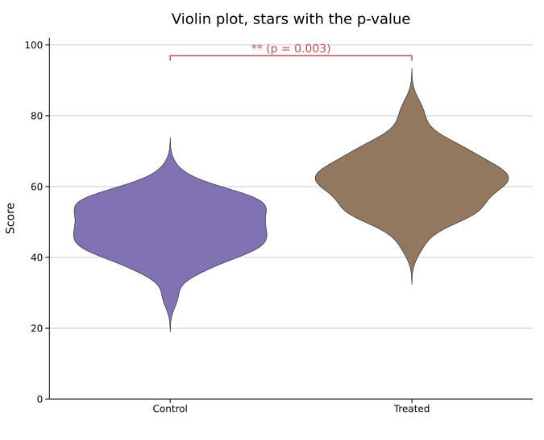
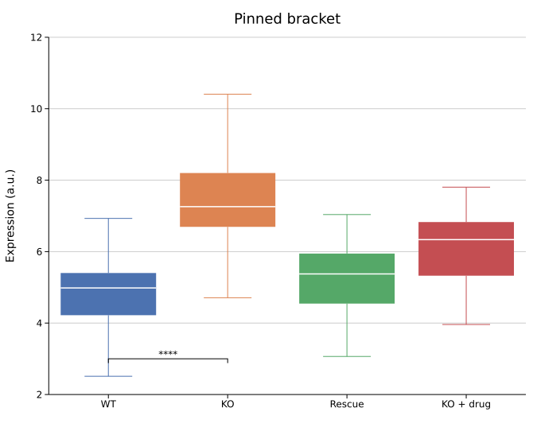
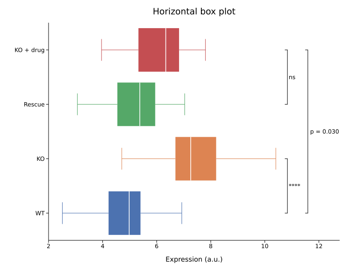
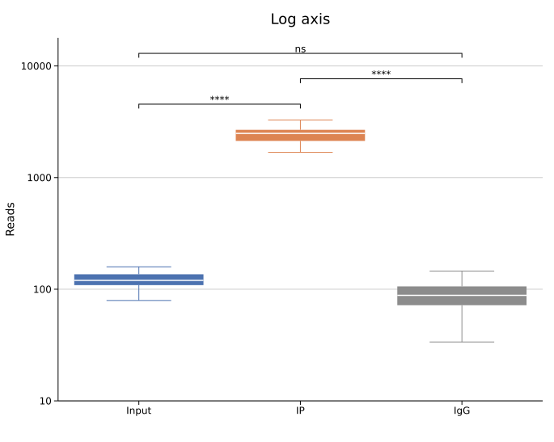

# Significance Brackets

A significance bracket spans two groups on a categorical axis and carries the result of a statistical comparison above it — `***`, `p = 0.003`, or any text you choose. It is the figure idiom of `stat_compare_means` and `statannotations`.

Brackets are a `Layout` feature, not a plot-type feature. They work on every plot whose groups sit on a category axis: bar, box, violin, strip and raincloud. kuva draws the bracket; the p-value comes from a test you ran elsewhere.

**Import path:** `kuva::plot::SignificanceBracket` (also `kuva::plot::annotations::SignificanceBracket` and the prelude)

---

## Basic usage

`Layout::with_significance(a, b, p)` adds a star-labelled bracket between groups `a` and `b`. Anchors are category labels as they appear in the plot, zero-based group indices (`usize`), or raw axis values (`f64`). Brackets stack automatically: adjacent pairs share the lowest level, a bracket that overlaps or touches another is lifted above it, and the value axis grows just enough to fit the stack.

```rust,no_run
use kuva::plot::BoxPlot;
use kuva::backend::svg::SvgBackend;
use kuva::render::render::render_multiple;
use kuva::render::layout::Layout;
use kuva::render::plots::Plot;

let plot = BoxPlot::new()
    .with_group("WT", vec![4.1, 5.0, 5.6, 4.8, 5.3])
    .with_group("KO", vec![6.9, 7.4, 8.1, 7.0, 7.7])
    .with_group("Rescue", vec![5.0, 5.5, 5.9, 5.2, 5.6])
    .with_group("KO + drug", vec![5.8, 6.3, 6.7, 6.0, 6.4]);

let plots = vec![Plot::Box(plot)];
let layout = Layout::auto_from_plots(&plots)
    .with_y_label("Expression (a.u.)")
    .with_significance("WT", "KO", 0.00002)
    .with_significance("KO", "Rescue", 0.0008)
    .with_significance("WT", "KO + drug", 0.03);

let svg = SvgBackend.render_scene(&render_multiple(plots, layout));
```



### Star thresholds

| p-value | Label |
|---------|-------|
| p < 0.0001 | `****` |
| p < 0.001 | `***` |
| p < 0.01 | `**` |
| p < 0.05 | `*` |
| otherwise | `ns` |

Change them with `.with_thresholds([0.05, 0.01, 0.001, 0.0001])` on a bracket; `p` earns one star per threshold it lies below, so the order does not matter.

---

## Label formats

Build a bracket with `SignificanceBracket::new(a, b, p)` and pick the label:

| Method | Label for p = 0.0031 |
|--------|----------------------|
| `.with_stars()` (default) | `**` |
| `.with_p_value_label()` | `p = 0.003` |
| `.with_both_labels()` | `** (p = 0.003)` |
| `.with_label("n.s.")` or `SignificanceBracket::text(a, b, "n.s.")` | `n.s.` |

Numeric labels use three decimals from 0.001 up, four below that, and `p < 0.0001` under the fourth decimal.

```rust,no_run
use kuva::plot::BarPlot;
use kuva::plot::annotations::SignificanceBracket;
use kuva::render::layout::Layout;
use kuva::render::plots::Plot;

let bar = BarPlot::new()
    .with_bar("Vehicle", 12.4)
    .with_bar("10 µM", 18.9)
    .with_bar("100 µM", 27.3)
    .with_error(vec![1.1, 1.6, 2.2]);

let plots = vec![Plot::Bar(bar)];
let layout = Layout::auto_from_plots(&plots)
    .with_bracket(SignificanceBracket::new("Vehicle", "10 µM", 0.041).with_p_value_label())
    .with_bracket(SignificanceBracket::new("Vehicle", "100 µM", 0.00031).with_p_value_label())
    .with_bracket(SignificanceBracket::text("10 µM", "100 µM", "n.s."));
```



---

## Styling

`with_color`, `with_stroke_width` and `with_font_size` apply per bracket. By default the stroke and label follow the theme's text colour, so brackets stay visible on the dark theme; an explicit colour is drawn as given for both.



---

## Positioning

A bracket with no explicit position is auto-stacked above the data maximum the plot reports — the tallest bar or error bar, or for box plots the upper whisker fence, which can sit a little above the drawn whisker when the largest value falls short of it. The pitch between levels is 7% of the axis or 2.2 times the label font, whichever is larger, so labels never run into the bar above them on a short canvas or at a large font size; the axis grows just enough to fit the top label (for horizontal brackets, the widest label). For horizontal brackets the pitch also clears the widest label, since those labels run sideways across the next level. In terminal output (`--terminal`) labels sit a full row above their bar and levels are at least three rows apart. `.with_position(y)` pins a bracket at a value in data units; a pinned bracket takes no part in stacking and never grows the axis. An explicit `with_y_axis_max` (or `with_x_axis_max` for horizontal plots) is always respected, so brackets that do not fit run into the margin rather than overriding your range.



### Horizontal plots

Orientation is inferred from the layout: a plot whose groups run along the y axis (it has `y_categories` and no `x_categories`, as `BoxPlot::with_horizontal(true)` produces) gets vertical brackets to the right of the data with labels beside them, and the x axis grows instead. `.with_horizontal()` on a bracket forces this when the layout cannot tell.



### Log axes

On a log value axis the stack is spaced in log units, so consecutive levels keep an even pixel pitch.



---

## CLI

`bar`, `box`, `violin`, `strip` and `raincloud` accept the same two flags:

| Flag | Default | Description |
|------|---------|-------------|
| `--signif <A,B,P>` | — | Bracket between groups A and B with p-value P. A and B are group labels, or `#i` for a zero-based group index; a non-numeric P (including `nan`) is drawn verbatim. Repeatable |
| `--signif-format <STYLE>` | `stars` | `stars`, `p`, or `both` |

```bash
kuva box samples.tsv --group-col group --value-col expression \
    --signif Control,Drug_A,0.0003 --signif Drug_A,Drug_B,0.04 --signif '#0,#4,n.s.'

kuva box samples.tsv --group-col group --value-col expression --horizontal \
    --signif Control,Drug_C,0.012 --signif-format p
```

Brackets follow `--horizontal` automatically. `--emit-code` emits the matching `with_bracket(...)` calls and rejects a bad spec the same way a real run does.

---

## API reference

### `Layout`

| Method | Description |
|--------|-------------|
| `with_bracket(SignificanceBracket)` | Add one bracket |
| `with_significance(a, b, p)` | Shortcut: star-labelled, auto-stacked bracket |

### `SignificanceBracket`

| Method | Description |
|--------|-------------|
| `new(a, b, p)` | Bracket between `a` and `b` for p-value `p`, star label |
| `text(a, b, text)` | Bracket with a verbatim label |
| `with_stars()` / `with_p_value_label()` / `with_both_labels()` | Label format |
| `with_label(text)` | Replace the label with text |
| `with_position(v)` | Pin at a value-axis position (data units) |
| `with_horizontal()` | Force groups-along-y (normally inferred from the layout) |
| `with_color(css)` / `with_stroke_width(px)` / `with_font_size(px)` | Styling; colour defaults to the theme's text colour |
| `with_thresholds([f64; 4])` | Star thresholds, any order |
| `label()` | The formatted label text |

### `BracketAnchor`

`From` is implemented for `&str` / `String` (category label), `usize` (zero-based index) and `f64` (axis value), so the anchor arguments above accept any of them directly. An unknown label draws no bracket.
